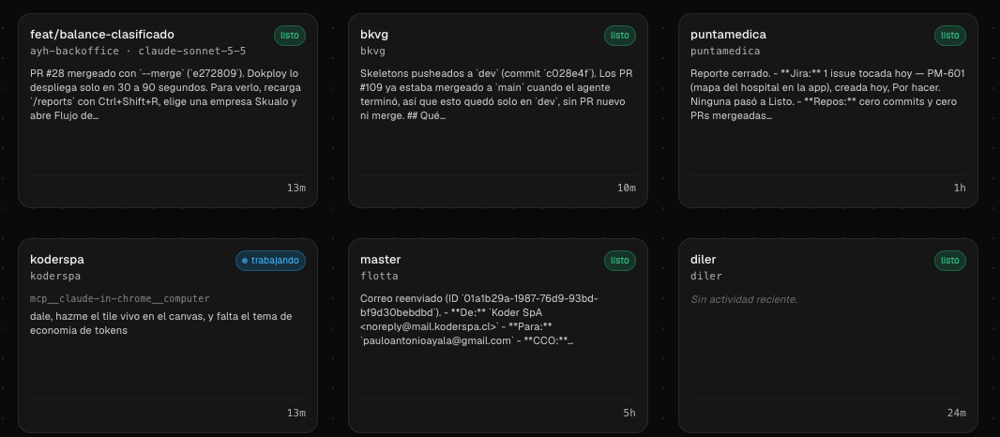

<h1 align="center">
  <a href="https://koderspa.com"></a> 信心
</h1>

<p align="center">
  
  <a href="https://github.com/stablyai/orca"></a>
  <a href="https://koderspa.com"></a>
  
</p>

<p align="center">
  <sub><a href="docs/readme/README.zh-CN.md">中文</a> · <a href="docs/readme/README.ja.md">日本語</a> · <a href="docs/readme/README.ko.md">한국어</a> · <a href="docs/readme/README.es.md">Español</a> · <a href="docs/readme/README.fr.md">Français</a> · <a href="docs/readme/README.pt.md">Português</a> · <a href="docs/readme/README.tr.md">Türkçe</a> · <a href="docs/readme/README.ru.md">Русский</a></sub>
</p>

<p align="center">
  <strong>The agent IDE for a software factory.</strong><br/>
  Run Claude Code, Codex, and any other coding agent in parallel, each in its own worktree. See all of it on one canvas, know what you hand each agent, and know what it costs.
</p>

<p align="center">
  <sub>信心 is a fork of <a href="https://github.com/stablyai/orca">Orca</a> (MIT) by <a href="https://koderspa.com">Koder SpA</a>. The name is 信心 (<i>xìnxīn</i>), "faith".</sub>
</p>

## What 信心 adds

<table>
<tr>
<td width="50%" valign="middle">

### Canvas

Every workspace on one surface instead of one at a time behind a click. Each tile shows the agent's own last words and its state — `working`, `waiting on you`, `blocked`, `watching`, `done`, `idle` — so "does this need me" is answerable from across the room.

The strongest state wins: if one pane waits on a permission prompt and another sits idle, the tile says `waiting on you`.

</td>
<td width="50%">
  
</td>
</tr>
<tr>
<td width="50%" valign="middle">

### Harness

What this project hands its agents, in one panel: every skill with its origin and lockfile coverage, and the MCP servers declared in the four config formats this app reads.

Three states per skill — **green** pinned in `skills-lock.json`, **amber** installed but unpinned, **red** declared in the lock and missing from disk. Lock coverage is reported as _declared_, not verified: the content hash is not recomputed yet.

</td>
<td width="50%">
  
</td>
</tr>
<tr>
<td width="50%" valign="middle">

### Token Economy

Orca already attributes each logged turn to the worktree that produced it and prices it, then shows the result only in a stats pane. 信心 puts those numbers on the tile you are already looking at, and keeps spend that belongs to no workspace separate instead of spreading it across the ones that exist.

Cost is an estimate from published per-model rates, never an invoice, and the scan stays opt-in because it reads your local agent logs.

</td>
<td width="50%" valign="middle">

```
Skills 10 · MCP 3 · Lock 7/10

feat/balance-clasificado   working
ayh-backoffice · claude-sonnet-5-5
1.2M · US$3.40                 13m
```

</td>
</tr>
</table>

---

## Inherited from Orca

<table>
<tr>
<td width="50%" valign="middle">

### Orchestrate Agents

Hand a big task to one agent. It splits the work, starts worker agents in their own workspaces, and brings their results back to you.

[Docs →](https://www.onorca.dev/docs/cli/orchestration)

</td>
<td width="50%">
  <a href="https://www.onorca.dev/docs/cli/orchestration"><picture><source srcset="docs/assets/readme-features/orchestration.webp" type="image/webp"></picture></a>
</td>
</tr>
<tr>
<td width="50%" valign="middle">

### Chat or Terminal

Run any agent in Chat UI or as the raw CLI, and move a conversation between the two without losing context.

[Docs →](https://www.onorca.dev/docs/agents/native-chat)

</td>
<td width="50%">
  <a href="https://www.onorca.dev/docs/agents/native-chat"><picture><source srcset="docs/assets/readme-features/chat-or-terminal.webp" type="image/webp"></picture></a>
</td>
</tr>
<tr>
<td width="50%" valign="middle">

### Run Anywhere

Pair a remote 信心 server, work on any SSH host, or give a worktree its own cloud VM. Your agents keep running when your laptop sleeps.

[Docs →](https://www.onorca.dev/docs/ways-to-run)

</td>
<td width="50%">
  <a href="https://www.onorca.dev/docs/ways-to-run"><picture><source srcset="docs/assets/readme-features/remote.webp" type="image/webp"></picture></a>
</td>
</tr>
<tr>
<td width="50%" valign="middle">

### Mobile App

Pair with a mobile app to get pinged when an agent needs you, reply in chat, and keep work moving when you are away from your desk.

Inherited from Orca and untested here — 信心 publishes no mobile build, and the store listings are Orca's own. [Docs →](https://www.onorca.dev/docs/mobile)

</td>
<td width="50%">
  <a href="https://www.onorca.dev/docs/mobile"><picture><source srcset="docs/assets/readme-features/mobile-companion.webp" type="image/webp"></picture></a>
</td>
</tr>
<tr>
<td width="50%" valign="middle">

### Review AI Output

Review diffs, leave notes on exact changed lines, and send focused feedback back to an agent.

[Docs →](https://www.onorca.dev/docs/review/annotate-ai-diff)

</td>
<td width="50%">
  <a href="https://www.onorca.dev/docs/review/annotate-ai-diff"><picture><source srcset="docs/assets/readme-features/annotate-ai-diffs.webp" type="image/webp"></picture></a>
</td>
</tr>
<tr>
<td width="50%" valign="middle">

### Git Integration

Draft commit messages and pull requests from the diff, then send failing checks or PR review comments back to an agent to fix.

[Docs →](https://www.onorca.dev/docs/review/commit-push)

</td>
<td width="50%">
  <a href="https://www.onorca.dev/docs/review/commit-push"><picture><source srcset="docs/assets/readme-features/git-integration.webp" type="image/webp"></picture></a>
</td>
</tr>
<tr>
<td width="50%" valign="middle">

### Parallel Worktrees

Quickly split tasks into isolated environments, so multiple agents can work side by side without interfering with each other.

[Docs →](https://www.onorca.dev/docs/model/worktrees)

</td>
<td width="50%">
  <a href="https://www.onorca.dev/docs/model/worktrees"><picture><source srcset="docs/assets/readme-features/parallel-worktrees.webp" type="image/webp"></picture></a>
</td>
</tr>
<tr>
<td width="50%" valign="middle">

### Design Mode

Click any element in 信心's browser to copy its HTML, styles, and selector, then paste it into your agent's chat.

[Docs →](https://www.onorca.dev/docs/browser/design-mode)

</td>
<td width="50%">
  <a href="https://www.onorca.dev/docs/browser/design-mode"><picture><source srcset="docs/assets/readme-features/design-mode.webp" type="image/webp"></picture></a>
</td>
</tr>
<tr>
<td width="50%" valign="middle">

### GitHub &amp; Linear, Native

See your GitHub, Jira and Linear tasks in one place, and start a workspace for each when you're ready to build.

[Docs →](https://www.onorca.dev/docs/review/linear)

</td>
<td width="50%">
  <a href="https://www.onorca.dev/docs/review/linear"><picture><source srcset="docs/assets/readme-features/github-linear-tasks.webp" type="image/webp"></picture></a>
</td>
</tr>
<tr>
<td width="50%" valign="middle">

### The CLI

Anything you can do in 信心, your agents can do too: create worktrees, start workers, drive the browser and desktop apps, and schedule automations, all from the command line.

[Docs →](https://www.onorca.dev/docs/cli/overview)

</td>
<td width="50%">
  <a href="https://www.onorca.dev/docs/cli/overview"><picture><source srcset="docs/assets/readme-features/orca-cli.webp" type="image/webp"></picture></a>
</td>
</tr>
<tr>
<td width="50%" valign="middle">

### Plugins

Themes, editors, languages, and panels from the community, installed in a click.

[Browse plugins →](https://www.onorca.dev/plugins)

</td>
<td width="50%">
  <a href="https://www.onorca.dev/plugins"><picture><source srcset="docs/assets/readme-features/plugins.webp" type="image/webp"></picture></a>
</td>
</tr>
<tr>
<td width="50%" valign="middle">

### Split Anything

Put agents, terminals, browsers, and diffs side by side in split panes shaped to the task.

[Docs →](https://www.onorca.dev/docs/model/tabs-panes-splits)

</td>
<td width="50%">
  <a href="https://www.onorca.dev/docs/model/tabs-panes-splits"><picture><source srcset="docs/assets/readme-features/split-anything.webp" type="image/webp"></picture></a>
</td>
</tr>
</table>

> Every **Docs →** link in this section points at Orca's documentation. These
> features come from upstream and work the same way in 信心; only Canvas, Harness
> and Token Economy are new here.

**Also in the box:**

- **[Drag Files to Agents](https://www.onorca.dev/docs/editing/file-explorer)**: drag files from the explorer, or images from your desktop, straight into an agent's prompt.
- **[Jump Anywhere](https://www.onorca.dev/docs/model/quick-open)**: one shortcut jumps to any workspace or tab across every repo and host.
- **[Rich Previews](https://www.onorca.dev/docs/editing/viewers)**: open images, PDFs, and Markdown right in the workspace, next to the agent that made them.
- **[Mobile Emulator](https://www.onorca.dev/docs/cli/overview#mobile-emulator)**: run an iOS Simulator or Android emulator beside your agent, and let it tap, type, and check its own work.
- **[Dictation](https://www.onorca.dev/docs/settings#voice)**: press a shortcut and talk. 信心 types what you say into the agent's prompt or terminal.
- **[Usage &amp; Accounts](https://www.onorca.dev/docs/agents/usage-tracking)**: see how much of your agent limits you've used and when they reset, and switch accounts without logging out.
- **[Automations](https://www.onorca.dev/docs/cli/automations)**: schedule prompts to run on any repo: nightly dependency bumps, weekly triage, flaky-test sweeps.
- **[Computer Use](https://www.onorca.dev/docs/cli/computer-use)**: when there's no CLI or API, agents can see and drive desktop apps and external browsers.
- **And many, many more**: we ship daily, so this list is perpetually behind. The [changelog](https://github.com/stablyai/orca/releases) is the real feature list.

---

## Supported Agents

Works with **any CLI agent** — if it runs in a terminal, it runs in 信心.

<p>
  <a href="https://docs.anthropic.com/claude/docs/claude-code"><kbd> Claude Code</kbd></a> &nbsp;
  <a href="https://github.com/openai/codex"><kbd> Codex</kbd></a> &nbsp;
  <a href="https://x.ai/cli"><kbd> Grok</kbd></a> &nbsp;
  <a href="https://cursor.com/cli"><kbd> Cursor</kbd></a> &nbsp;
  <a href="https://docs.github.com/en/copilot/how-tos/set-up/install-copilot-cli"><kbd> GitHub Copilot</kbd></a> &nbsp;
  <a href="https://dev.meta.ai/docs/muse-code"><kbd> Muse</kbd></a> &nbsp;
  <a href="https://deepseek-harness.github.io/deepseek-harness/"><kbd> DeepSeek Harness</kbd></a> &nbsp;
  <a href="https://zcode.z.ai/en/docs"><kbd> ZCode</kbd></a> &nbsp;
  <a href="https://opencode.ai/docs/cli/"><kbd> OpenCode</kbd></a> &nbsp;
  <a href="https://mimo.xiaomi.com/coder"><kbd> MiMo Code</kbd></a> &nbsp;
  <a href="https://ampcode.com/manual#install"><kbd> Amp</kbd></a> &nbsp;
  <a href="https://openclaude.gitlawb.com/"><kbd> OpenClaude</kbd></a> &nbsp;
  <a href="https://antigravity.google/docs/cli-overview"><kbd> Antigravity</kbd></a> &nbsp;
  <a href="https://pi.dev"><kbd> Pi</kbd></a> &nbsp;
  <a href="https://omp.sh"><kbd> oh-my-pi</kbd></a> &nbsp;
  <a href="https://hermes-agent.nousresearch.com/docs/"><kbd> Hermes Agent</kbd></a> &nbsp;
  <a href="https://devin.ai/cli"><kbd> Devin</kbd></a> &nbsp;
  <a href="https://goose-docs.ai/docs/quickstart/"><kbd> Goose</kbd></a> &nbsp;
  <a href="https://docs.augmentcode.com/cli/overview"><kbd> Auggie</kbd></a> &nbsp;
  <a href="https://github.com/autohandai/code-cli"><kbd> Autohand Code</kbd></a> &nbsp;
  <a href="https://github.com/charmbracelet/crush"><kbd> Charm</kbd></a> &nbsp;
  <a href="https://docs.cline.bot/cline-cli/overview"><kbd> Cline</kbd></a> &nbsp;
  <a href="https://www.codebuddy.ai/cli"><kbd> CodeBuddy</kbd></a> &nbsp;
  <a href="https://www.codebuff.com/docs/help/quick-start"><kbd> Codebuff</kbd></a> &nbsp;
  <a href="https://freebuff.com"><kbd> Freebuff</kbd></a> &nbsp;
  <a href="https://commandcode.ai/docs/quickstart"><kbd> Command Code</kbd></a> &nbsp;
  <a href="https://docs.continue.dev/cli/quickstart"><kbd> Continue</kbd></a> &nbsp;
  <a href="https://docs.factory.ai/cli/getting-started/quickstart"><kbd> Droid</kbd></a> &nbsp;
  <a href="https://kilo.ai/docs/cli"><kbd> Kilocode</kbd></a> &nbsp;
  <a href="https://www.kimi.com/code/docs/en/kimi-code-cli/getting-started.html"><kbd> Kimi</kbd></a> &nbsp;
  <a href="https://kiro.dev/docs/cli/"><kbd> Kiro</kbd></a> &nbsp;
  <a href="https://github.com/mistralai/mistral-vibe"><kbd> Mistral Vibe</kbd></a> &nbsp;
  <a href="https://github.com/QwenLM/qwen-code"><kbd> Qwen Code</kbd></a> &nbsp;
  <a href="https://support.atlassian.com/rovo/docs/install-and-run-rovo-dev-cli-on-your-device/"><kbd> Rovo Dev</kbd></a> &nbsp;
  <kbd>+ any CLI agent</kbd>
</p>

---

## Install

信心 has no published builds yet. Run it from source — Node 22+ and pnpm 12.

```bash
git clone https://github.com/FranciscoYuster/lili.git
cd lili
pnpm install
```

### Desktop — macOS, Windows, Linux

```bash
pnpm dev
```

### Web

```bash
pnpm dev:web                                                          # client on :5173
node config/scripts/development/launch/orca-dev.mjs serve --port 6768  # runtime
```

Then open `http://127.0.0.1:5173/web-index.html`. The `/` route is the Electron
entry and needs the preload bridge; in a browser, use `web-index.html`.

_Signed upstream builds, if you want Orca itself instead:_
[onOrca.dev](https://onorca.dev/download) · `brew install --cask stablyai/orca/orca` · `yay -S stably-orca-bin`

### Build an app bundle

```bash
pnpm build:unpack   # dist/mac-arm64/信心.app, unsigned
```

Unsigned, so macOS blocks it the first time: right-click the app, then Open.

---

## Support

信心 has no community of its own. Issues and requests go to
[this repo](https://github.com/FranciscoYuster/lili/issues).

Everything upstream — Discord, feature requests, telemetry and privacy docs —
belongs to [Orca](https://github.com/stablyai/orca), and so does the credit:
信心 exists because they ship daily.

---

## Developing

Want to contribute or run locally? See the [CONTRIBUTING.md](.github/CONTRIBUTING.md) guide.

```bash
pnpm typecheck     # TypeScript across every project
npx oxlint src     # lint
npx oxfmt --write  # format
```

信心's own code lives in `src/renderer/src/koder/`. Every change to an upstream
file is listed one by one in [KODER-PATCHES.md](KODER-PATCHES.md), so merging
upstream stays cheap. Branding is applied by a re-runnable script
(`scripts/rebrand-xinxin.mjs`), never by hand — which is also why `~/.orca/`,
`orca://` and `ORCA_*` survive untouched: renaming them would break every merge
and orphan your saved credentials.

### Contributors

信心 is built by [Francisco Yuster](https://github.com/FranciscoYuster) at
[Koder SpA](https://koderspa.com).

Upstream's contributors are credited on [Orca's own
repo](https://github.com/stablyai/orca/graphs/contributors).

## Credits &amp; License

信心 is a fork of [Orca](https://github.com/stablyai/orca) by Stably AI, under the
MIT License. All credit for the base belongs to its authors and contributors.

信心 is free and open source under the same [MIT License](LICENSE).
