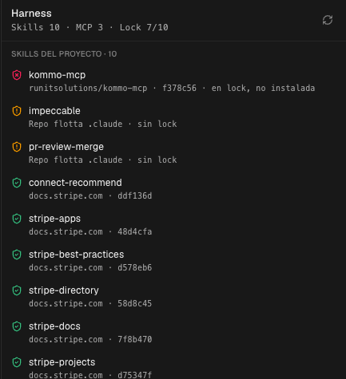

<h1 align="center">
  <br/>
  lili
</h1>

<p align="center">
  
  
  
</p>

<p align="center">
  <strong>El IDE de agentes para una fábrica de software.</strong><br/>
  Corre Claude Code, Codex y cualquier otro agente en paralelo, ve todo tu trabajo
  en un solo lienzo, y sabe qué skills, qué MCP y cuántos tokens lleva cada proyecto.
</p>

---

## Qué es

**lili** es un fork de [Orca](https://github.com/stablyai/orca) (MIT) hecho por
[Koder SpA](https://koderspa.com). Orca resuelve bien lo difícil: correr muchos
agentes en paralelo, cada uno aislado en su propio worktree, con chat o terminal,
diffs, navegador y CLI en una sola app.

lili agrega lo que falta cuando eso deja de ser un experimento y pasa a ser tu
operación: **ver todo junto, saber qué le entregas a cada agente, y saber cuánto
cuesta.**

El nombre viene de 历历 (_lìlì_), «cada detalle, con claridad» — de 历历在目, cosas
tan nítidas que parecen estar frente a tus ojos.

---

## Lo que agrega lili

### Canvas

Todos tus espacios de trabajo en un lienzo, no uno a la vez detrás de un clic.


Cada tile muestra **lo último que dijo el agente**, no un resumen del workspace, y
su estado en seis niveles:

| Estado       | Qué significa                                                   |
| ------------ | --------------------------------------------------------------- |
| `trabajando` | Hay un turno en curso.                                          |
| `te espera`  | El agente tiene una pregunta y nada avanza hasta que respondas. |
| `trancado`   | Se detuvo por un error.                                         |
| `observando` | Trabajo de fondo que no ocupa al agente.                        |
| `listo`      | El turno terminó.                                               |
| `quieto`     | Sin evidencia fresca — no es lo mismo que terminado.            |

Gana el estado más fuerte del espacio: si una pestaña espera permiso y la otra está
quieta, el tile dice `te espera`, que es la única razón para mirar la pantalla.

Rueda para desplazar, `cmd`+rueda para zoom, arrastrar para mover, doble clic para
abrir, `0` para volver al centro. Las posiciones se guardan por navegador.

### Harness

Qué le entrega este proyecto a sus agentes, en una pestaña del panel derecho.



```
Skills 10 · MCP 3 · Lock 7/10
```

Tres estados por skill, y los tres accionables:

- **verde** — declarada en `skills-lock.json` y presente en disco
- **ámbar** — instalada pero sin fijar: puede cambiar sin que te enteres
- **rojo** — el lock la declara y no está: el harness tiene un hoyo

Abajo, los servidores MCP del proyecto con su transporte y destino, leídos de
`.mcp.json`, `.cursor/mcp.json`, `.claude.json` o `.claude/mcp.json`.

Las skills del equipo se cuentan aparte: la cuenta de arriba es solo de este
proyecto.

> El lock se lee **declarado**, no verificado. lili compara nombres contra
> `skills-lock.json`; todavía no recalcula el hash del contenido. Y «MCP 3» son los
> servidores configurados, no los conectados — los abre el agente, no lili.

### Economía de tokens

Orca ya atribuye cada turno del log de Claude al worktree que lo originó y le pone
precio. lili lo saca del panel de estadísticas y lo pone en el tile:

```
1.2M · US$3.40
```

El consumo que no cae en ningún espacio de trabajo se muestra aparte, sin
repartirlo a dedo entre los que sí.

> Es **costo estimado, no facturado**: tarifas publicadas por tokens registrados.
> Con suscripción no pagas por token, y un modelo sin precio suma tokens y cero
> dólares. El escaneo lee tus logs locales y está apagado hasta que lo enciendas.

---

## Lo que hereda de Orca

- **Orquestación.** Un agente parte el trabajo y lanza agentes trabajadores en sus
  propios espacios.
- **Chat o terminal.** El mismo agente en interfaz de chat o como CLI cruda, y
  mover la conversación entre las dos sin perder contexto.
- **Worktrees en paralelo.** Cada espacio aislado, o carpetas simples cuando no
  quieres ramas.
- **Jira y GitHub nativos.** Issues, comentarios, transiciones, campos ágiles,
  filtros guardados y conversión ADF↔markdown.
- **Sesiones indexadas.** Reanuda sesiones de Claude Code que empezaste fuera de la
  app, en un chat nuevo o en un worktree, o pásalas a otro agente.
- **Más de 40 agentes.** Claude Code, Codex, Gemini, Cursor, Copilot, Droid, Amp y
  el resto.
- **Móvil, revisión de diffs, navegador, plugins y CLI.**

---

## Instalar

No hay binarios publicados todavía. Para correrlo desde el código:

```bash
git clone https://github.com/FranciscoYuster/lili.git
cd lili
pnpm install
```

**Escritorio:**

```bash
pnpm dev
```

**Web:**

```bash
pnpm dev:web                                            # cliente en :5173
node config/scripts/development/launch/orca-dev.mjs serve --port 6768   # runtime
```

Luego abre `http://127.0.0.1:5173/web-index.html`. La ruta `/` es la entrada de
Electron y necesita el puente de preload; en el navegador usa `web-index.html`.

Requiere Node 22+ y pnpm 12.

---

## Desarrollar

```bash
pnpm typecheck     # TypeScript en todos los proyectos
npx oxlint src     # lint
npx oxfmt --write  # formato
```

El código propio de lili vive en `src/renderer/src/koder/`. Los cambios sobre
archivos de Orca están anotados uno por uno en
[KODER-PATCHES.md](KODER-PATCHES.md), para que traer cambios de upstream siga
siendo barato. La marca se aplica con un script re-ejecutable
(`scripts/rebrand-lili.mjs`), no a mano.

---

## Créditos y licencia

lili es un fork de [Orca](https://github.com/stablyai/orca), de Stably AI, bajo
licencia MIT. Todo el mérito del trabajo base es de sus autores y contribuidores.

lili se distribuye bajo la misma [licencia MIT](LICENSE).

Firma de código en Windows heredada de Orca: patrocinada por
[SignPath.io](https://signpath.io), certificado de
[SignPath Foundation](https://signpath.org).
